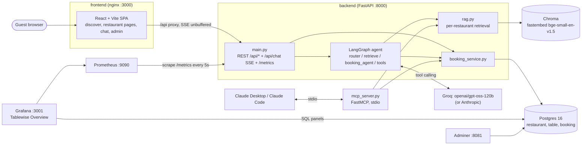
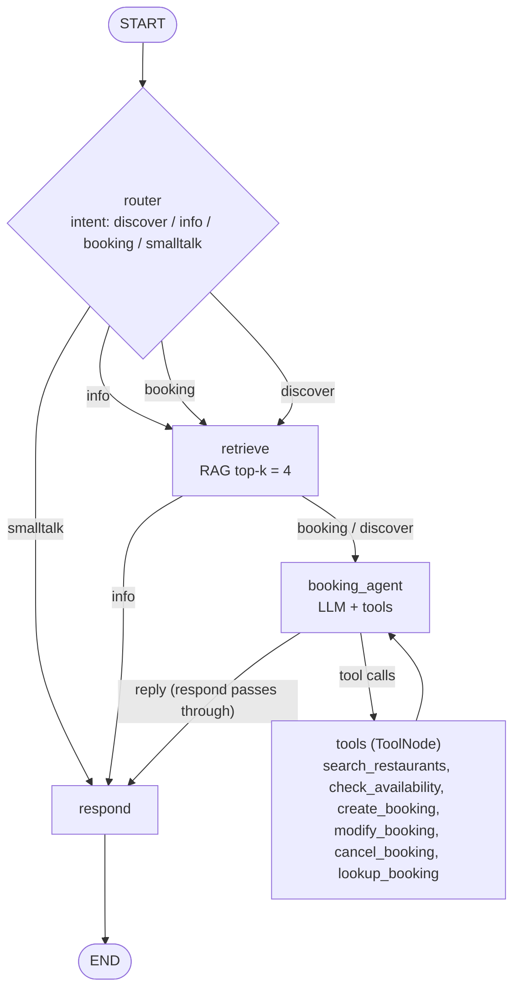

# Tablewise: discover and book Mumbai restaurants with an AI host

Tablewise is a restaurant discovery and table-booking app for **Mumbai**. It covers six fictional restaurants across Lower Parel, Bandra, Powai, Juhu, Colaba and Andheri: Ember & Vine, Trattoria Alba, Saffron Terrace, Koli & Tide, Kanji House and Tulsi Thali House. Guests filter by area, cuisine, price, tags (rooftop, bar, pet-friendly, pure-veg, live music) and party size, and see the next free slots for each place. They can also just chat ("rooftop for 4 in Bandra tonight?", "is Koli & Tide pet friendly?"). A LangGraph agent finds matching restaurants, answers from each restaurant's own knowledge base (menu, allergens, policies, parking) with citations, checks real table availability, and creates, modifies or cancels bookings in Postgres. Every step streams to a React UI over SSE. The same booking and RAG services are exposed as an **MCP server**, so Claude Desktop or Claude Code can book too. Prometheus and Grafana show bookings, API traffic and AI-concierge health live.

## Team

| Member | GitHub | Area |
|---|---|---|
| Arya Bailur | @aryabailur | Backend: booking engine, RAG, AI concierge, MCP |
| Irisha Deshpande | @ahsiri14 | Frontend and Google Maps page |
| devv296 | @devv296 | DevOps: Jenkins, Docker, GitHub Actions, CI/CD docs |

## Run with Docker (recommended)

Prereqs: Docker Desktop. Optionally put `GROQ_API_KEY=...` in `backend/.env` (copy `backend/.env.example`) or export it in your shell. Without a key the app runs in offline demo mode.

```bash
docker compose up -d --build      # postgres, backend, frontend, adminer, prometheus, grafana
python scripts/load_demo.py       # ~2 min of demo traffic: ~30 bookings + ~20 chat turns
```

On first start the backend waits for Postgres. If the `restaurant` table is missing or empty it runs `python -m app.seed` (6 restaurants, tables, demo bookings, knowledge -> Chroma), then starts uvicorn. Chroma and the fastembed model cache live in named volumes, so later starts are fast. `docker compose down -v` wipes everything for a fresh seed.

| Service | URL | Login |
|---|---|---|
| App (nginx + React) | http://localhost:3000 | none |
| API docs (FastAPI) | http://localhost:8000/docs | none |
| Grafana | http://localhost:3001 (dashboard: http://localhost:3001/d/tablewise-overview) | admin / admin (anonymous viewers allowed) |
| Prometheus | http://localhost:9090 | none |
| Adminer | http://localhost:8081 | System PostgreSQL, server `postgres`, user `tablewise`, password `tablewise`, database `tablewise` |
| Jenkins (separate `tablewise-jenkins` container) | http://localhost:8080 | admin / admin |

The **Tablewise Overview** dashboard has two halves. From Postgres: bookings today, bookings by restaurant, bookings by source, and bookings per day for the next 7 days. From Prometheus (scraped from `backend:8000/metrics` every 5s): API requests/sec and p95 latency, chat requests by intent, chat latency p95, RAG retrieval p95 and LLM errors.

## Local dev without Docker (Windows first)

Prereqs: Python 3.11, [uv](https://docs.astral.sh/uv/) (`powershell -c "irm https://astral.sh/uv/install.ps1 | iex"`, which installs to `%USERPROFILE%\.local\bin`; add that to PATH), Node 20+.

```powershell
cd backend
uv sync
copy .env.example .env          # then set GROQ_API_KEY=... in backend\.env
uv run python -m app.seed       # 6 restaurants, tables, demo bookings, knowledge -> Chroma
cd ..
cd frontend
npm install
cd ..
python scripts\dev.py           # API :8000 + web :5173, prefixed [api]/[web]; Ctrl+C stops both
```

Open http://localhost:5173. With no API key the app still runs in **offline demo mode** (see trade-offs).

With `make` (macOS/Linux, or Windows with Git Bash + make):

```bash
make setup   # uv sync (or venv + pip fallback) + npm install
make seed
make dev     # python scripts/dev.py
make mcp     # MCP server over stdio
make build   # frontend production build
```

## Architecture



### LangGraph



State: `{messages, intent, retrieved_docs, tool_results, booking_draft}`. The checkpointer is `MemorySaver`, keyed by `thread_id`.

## API

| Method | Path | Notes |
|---|---|---|
| GET | `/api/restaurants?q=&area=&cuisine=&price_level=&tags=&party_size=&date=&time=` | list + filter, each with `next_slots` |
| GET | `/api/restaurants/{slug}` | restaurant + `docs` (about, menu, policies) |
| GET | `/api/restaurants/{slug}/tables` | that restaurant's tables |
| GET | `/api/restaurants/{slug}/availability?date=YYYY-MM-DD&party_size=N` | slots with free tables |
| POST | `/api/restaurants/{slug}/bookings` | create (`source`: web, chat, mcp, google, phone) |
| GET / PATCH / DELETE | `/api/bookings/{code}` | look up / modify / cancel (codes like `EMB-7K2P`, globally unique) |
| GET | `/api/bookings?date=YYYY-MM-DD&restaurant=slug` | bookings for a day (admin view) |
| POST | `/api/chat` | body `{message, thread_id, restaurant_slug?}` -> `text/event-stream` |
| GET | `/api/health` | `{status, llm, provider, model, documents, restaurants}` |
| GET | `/metrics` | Prometheus metrics |

Legacy single-venue routes (`/api/availability`, `/api/tables`, `POST /api/bookings`) still work and default to `ember-vine` (pass `?restaurant=slug`).

SSE events (`data: {json}` per line):

| `type` | Payload | Meaning |
|---|---|---|
| `node` | `node, status` (`start`/`end`), `intent` on router end | graph progress |
| `token` | `content` | streamed reply text |
| `tool` | `id, name, args` / `status: end` + result | tool call and result |
| `sources` | `sources[]` (source file + section + `restaurant_slug`) | RAG citations |
| `restaurants` | `restaurants[]` (restaurant + `next_slots`) | results of `search_restaurants` |
| `booking` | `action, booking` | booking created / modified / cancelled |
| `error` | `message` | failure, stream still ends with `done` |
| `done` | (none) | end of turn |

## MCP server

Tools: `search_restaurant_info`, `check_availability`, `create_booking`, `get_booking`, `modify_booking`, `cancel_booking`. It shares `booking_service` and `rag` with the API, so the same rules apply everywhere. Run it with `cd backend && uv run python mcp_server.py`.

**Claude Desktop**: edit `%APPDATA%\Claude\claude_desktop_config.json`:

```json
{
  "mcpServers": {
    "ember-and-vine": {
      "command": "C:\\Users\\aryab\\OneDrive\\Desktop\\asdnd mpr\\backend\\.venv\\Scripts\\python.exe",
      "args": ["C:\\Users\\aryab\\OneDrive\\Desktop\\asdnd mpr\\backend\\mcp_server.py"]
    }
  }
}
```

**Claude Code**:

```bash
claude mcp add ember-and-vine -- "C:\Users\aryab\OneDrive\Desktop\asdnd mpr\backend\.venv\Scripts\python.exe" "C:\Users\aryab\OneDrive\Desktop\asdnd mpr\backend\mcp_server.py"
```

Data paths resolve from the source files, not the working directory, so any launcher can start it. Run the seed first.

## v2 decisions

- **Multi-restaurant data model (TAB-40).** The model is `restaurant` -> `table` -> `booking`. Every booking carries `restaurant_id` and a `source`. Booking codes use the restaurant prefix (`EMB-`, `ALB-`, `SAF-`, `KOL-`, `KNJ-`, `TUL-`) and are globally unique, so `/api/bookings/{code}` needs no slug.
- **Per-restaurant hours and seating.** Each restaurant has its own open and close times with 30-minute slots. The last seating is close minus the 90-minute default duration. Kanji House closes at midnight, which is stored as 23:59.
- **Per-restaurant RAG (TAB-41).** Chunks carry `restaurant_slug`. Retrieval filters to the selected restaurant, or searches all six when none is selected.
- **Discover intent (TAB-42).** The router gained `discover`, and `booking_agent` got a `search_restaurants` tool. Its results stream as a `restaurants` SSE event and render as cards.
- **SQLite -> Postgres 16.** Postgres handles concurrent bookings, gives Grafana panels real SQL and adds an Adminer view.
- **Docker Compose for the whole stack.** All images are pinned (postgres 16.4, adminer 4.8.1, prometheus v2.54.1, grafana 11.2.0, python 3.11-slim, node 20 -> nginx 1.27). The backend seeds itself on first boot. Host port 8080 stays free for Jenkins.
- **nginx in front of the SPA.** It serves the built assets, falls back to `index.html` for client routes, and proxies `/api/` with `proxy_buffering off` so chat tokens stream.
- **Metrics (TAB-44).** `prometheus-fastapi-instrumentator` covers HTTP rate and latency. Custom series cover the product: `tablewise_bookings_created_total{restaurant,source}`, `tablewise_bookings_cancelled_total{restaurant}`, `tablewise_chat_requests_total{intent}`, `tablewise_chat_latency_seconds`, `tablewise_rag_retrieval_seconds` and `tablewise_llm_errors_total`.
- **Grafana as code (TAB-45).** The datasources (uids `prometheus` and `postgres`) and the Tablewise Overview dashboard are provisioned from `grafana/provisioning`. Business panels query Postgres directly; operational panels use Prometheus.
- **LLM settings from the host or `backend/.env`.** Compose reads `backend/.env` when it exists. `LLM_PROVIDER`, `GROQ_API_KEY`, `LLM_MODEL` and `ANTHROPIC_API_KEY` set in the host shell take precedence.
- **Demo traffic script.** `scripts/load_demo.py` uses only the standard library, so it runs on any Python 3.9+ without a venv.

## Decisions & trade-offs (from v1, still apply)

- **Groq by default.** The app uses `langchain-groq` with `openai/gpt-oss-120b`, the strongest tool-calling model on the available key. Set `LLM_PROVIDER=anthropic` (default model `claude-sonnet-4-5`) to switch. `LLM_MODEL` overrides either default.
- **Router**: structured-output intent (`info | booking | smalltalk`), with a keyword heuristic as the fallback.
- **Respond passes through on the booking path.** `booking_agent` writes the guest-facing reply, grounded in the same retrieved docs, which saves one LLM call per turn.
- **Confirm before creating.** The agent always recaps the details and asks for a yes before `create_booking`. The server date is injected into prompts, so "tomorrow" and "Friday" resolve correctly.
- **Sanitized history.** Dangling tool calls and orphan tool results are dropped, and the window is trimmed to start on a human turn, so provider APIs don't reject the transcript.
- **Seating rules.** Seatings run every 30 min within each restaurant's hours, and the last seating is 90 min before close. Each booking holds its table for 90 min. All six are open 7 days; bookings up to 60 days ahead.
- **Party sizes 1–12.** Larger parties go to the events team. The smallest free table that fits is auto-assigned, so big tables stay available. Zones vary per restaurant (window, garden, bar, private, rooftop, patio).
- **Short codes** like `EMB-7K2P`: easy to read over the phone.
- **Naive local datetimes.** All times are Mumbai-local. IST has no DST, so there's no timezone handling.
- **RAG.** Knowledge files are chunked by heading at about 400 tokens with 50 overlap (a word-count approximation), with `source` + `section` metadata. Ingest is idempotent (drop and rebuild). fastembed runs locally, so no embedding API key is needed.
- **Offline demo mode.** With no key, the keyword router and extractive answers take over. Chat can check availability, look up and cancel bookings, but not create them. REST and MCP still can.
- **In-memory chat memory** (`MemorySaver`): conversations reset when the API restarts.
- **No auth on the admin view** (`GET /api/bookings`). This is for demo only; add auth before any real deployment.

## Try it

- "Any rooftop places in Bandra for 4 tonight?"
- "Do you have vegan options at Trattoria Alba?"
- "Book a table for 2 at Kanji House on Friday at 8pm"
- "Cancel booking EMB-XXXX"
