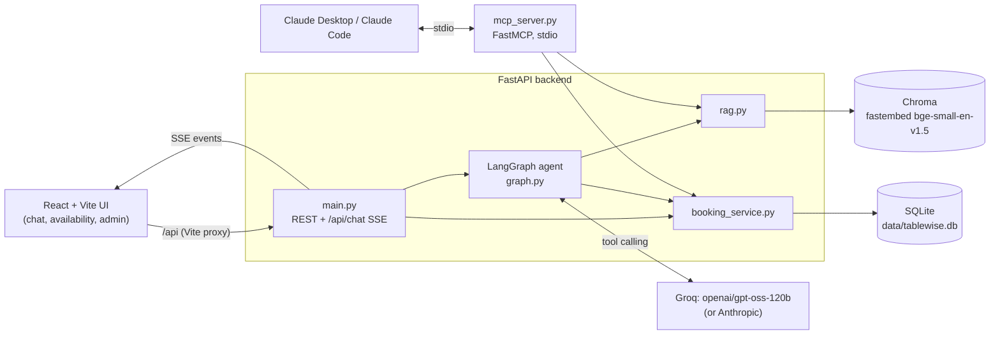
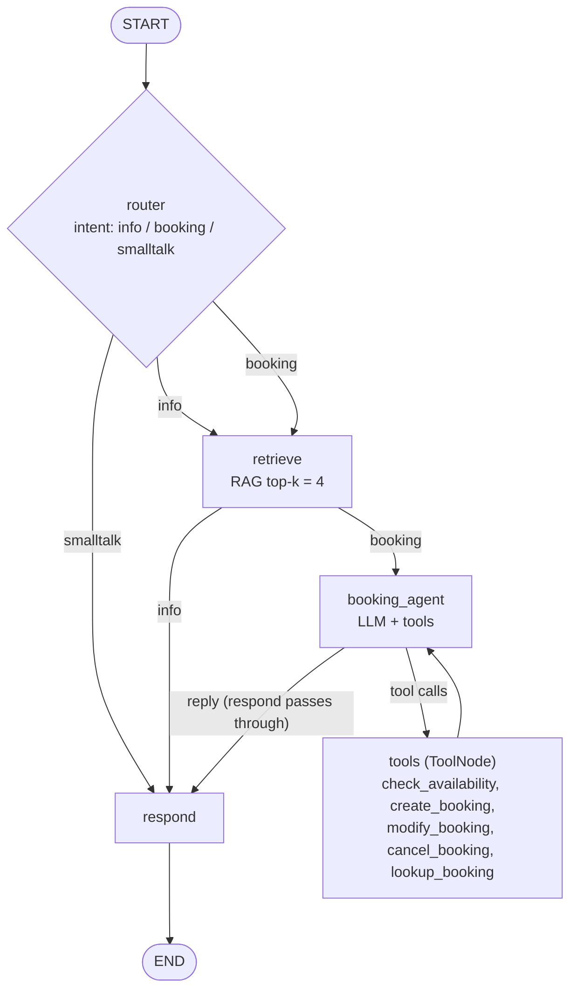

# Tablewise: AI reservations for Ember & Vine

Tablewise is an AI host for **Ember & Vine**, a fictional restaurant. Guests chat in plain language ("table for 4 tomorrow at 8 in the garden?") and a LangGraph agent answers questions from the restaurant's own knowledge base (menu, allergens, policies, parking) with citations. It also checks real table availability and creates, modifies or cancels bookings in SQLite, and streams every step to a React UI over SSE. The same booking and RAG services are exposed as an **MCP server**, so Claude Desktop or Claude Code can run the restaurant's book too.

## Quickstart (Windows first)

Prereqs: Python 3.11, [uv](https://docs.astral.sh/uv/) (`powershell -c "irm https://astral.sh/uv/install.ps1 | iex"`, which installs to `%USERPROFILE%\.local\bin`; add that to PATH), Node 20+.

```powershell
cd backend
uv sync
copy .env.example .env          # then set GROQ_API_KEY=... in backend\.env
uv run python -m app.seed       # 14 tables, demo bookings, knowledge/*.md -> Chroma
cd ..
cd frontend
npm install
cd ..
python scripts\dev.py           # API :8000 + web :5173, prefixed [api]/[web]; Ctrl+C stops both
```

Open http://localhost:5173. With no API key the app still runs in **offline demo mode** (see trade-offs).

With `make` (macOS/Linux, or Windows with Git Bash + make):

```bash
make setup   # uv sync (or venv + pip fallback) + npm install
make seed
make dev     # python scripts/dev.py
make mcp     # MCP server over stdio
make build   # frontend production build
```

## Architecture



### LangGraph



State: `{messages, intent, retrieved_docs, tool_results, booking_draft}`. The checkpointer is `MemorySaver`, keyed by `thread_id`.

## API

| Method | Path | Notes |
|---|---|---|
| POST | `/api/chat` | body `{message, thread_id}` → `text/event-stream` |
| GET | `/api/health` | `{status, llm, provider, model, documents}` |
| GET | `/api/tables` | the 14 tables |
| GET | `/api/availability?date=YYYY-MM-DD&party_size=N` | free seatings |
| POST | `/api/bookings` | create |
| GET / PATCH / DELETE | `/api/bookings/{code}` | look up / modify / cancel (`EV-XXXX`) |
| GET | `/api/bookings?date=YYYY-MM-DD` | bookings for a day (admin view) |

SSE events (`data: {json}` per line):

| `type` | Payload | Meaning |
|---|---|---|
| `node` | `node, status` (`start`/`end`), `intent` on router end | graph progress |
| `token` | `content` | streamed reply text |
| `tool` | `id, name, args` / `status: end` + result | tool call and result |
| `sources` | `sources[]` (source file + section) | RAG citations |
| `booking` | `action, booking` | booking created / modified / cancelled |
| `error` | `message` | failure, stream still ends with `done` |
| `done` | (none) | end of turn |

## MCP server

Tools: `search_restaurant_info`, `check_availability`, `create_booking`, `get_booking`, `modify_booking`, `cancel_booking`. It shares `booking_service` and `rag` with the API, so the same rules apply everywhere. Run it with `cd backend && uv run python mcp_server.py`.

**Claude Desktop**: edit `%APPDATA%\Claude\claude_desktop_config.json`:

```json
{
  "mcpServers": {
    "ember-and-vine": {
      "command": "C:\\Users\\aryab\\OneDrive\\Desktop\\asdnd mpr\\backend\\.venv\\Scripts\\python.exe",
      "args": ["C:\\Users\\aryab\\OneDrive\\Desktop\\asdnd mpr\\backend\\mcp_server.py"]
    }
  }
}
```

**Claude Code**:

```bash
claude mcp add ember-and-vine -- "C:\Users\aryab\OneDrive\Desktop\asdnd mpr\backend\.venv\Scripts\python.exe" "C:\Users\aryab\OneDrive\Desktop\asdnd mpr\backend\mcp_server.py"
```

Data paths resolve from the source files, not the working directory, so any launcher can start it. Run the seed first.

## Decisions & trade-offs

- **Groq by default.** The app uses `langchain-groq` with `openai/gpt-oss-120b`, the strongest tool-calling model on the available key. Set `LLM_PROVIDER=anthropic` (default model `claude-sonnet-4-5`) to switch. `LLM_MODEL` overrides either default.
- **Router**: structured-output intent (`info | booking | smalltalk`), with a keyword heuristic as the fallback.
- **Respond passes through on the booking path.** `booking_agent` writes the guest-facing reply, grounded in the same retrieved docs, which saves one LLM call per turn.
- **Confirm before creating.** The agent always recaps the details and asks for a yes before `create_booking`. The server date is injected into prompts, so "tomorrow" and "Friday" resolve correctly.
- **Sanitized history.** Dangling tool calls and orphan tool results are dropped, and the window is trimmed to start on a human turn, so provider APIs don't reject the transcript.
- **Seating rules.** Seatings run every 30 min from 17:00 to 22:00. The last seating is 22:00 even though service ends at 23:00. Each booking holds its table for 90 min. Open 7 nights; bookings up to 60 days ahead.
- **Party sizes 1–12.** Larger parties go to the events team. The smallest free table that fits is auto-assigned, so big tables stay available. The 14 tables are window W1–W4, garden G1–G4, bar B1–B3 and private P1–P3.
- **Short codes** like `EV-7K2P`: easy to read over the phone.
- **Naive local datetimes.** All times are restaurant-local. This is simple for a single venue, but there's no timezone or DST handling.
- **RAG.** Knowledge files are chunked by heading at about 400 tokens with 50 overlap (a word-count approximation), with `source` + `section` metadata. Ingest is idempotent (drop and rebuild). fastembed runs locally, so no embedding API key is needed.
- **Offline demo mode.** With no key, the keyword router and extractive answers take over. Chat can check availability, look up and cancel bookings, but not create them. REST and MCP still can.
- **In-memory chat memory** (`MemorySaver`): conversations reset when the API restarts.
- **No auth on the admin view** (`GET /api/bookings`). This is for demo only; add auth before any real deployment.

## Try it

- "Do you have vegan options?"
- "Book a table for 4 tomorrow at 8pm in the garden"
- "Cancel booking EV-XXXX"
